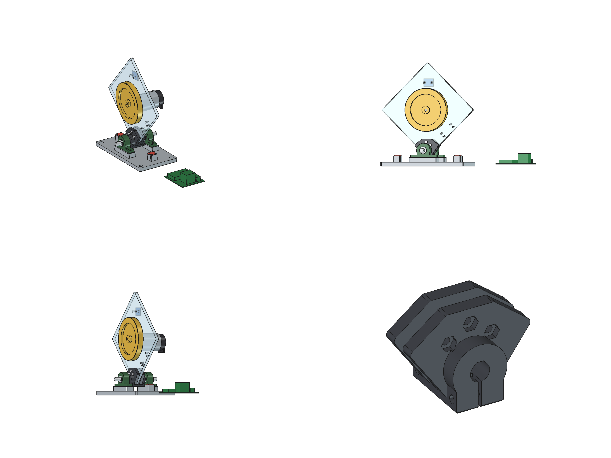

# 1-Wheel Balance Cube — CAD & Mechanical Fabrication Guide

This guide covers the parametric FreeCAD CAD suite in [`cad/`](../cad/), how its geometry and mass properties are checked against [params_1d_cube.m](../simulink/params_1d_cube.m), and how to make every part.

**Manufacturing split**

| Process | Parts |
|---|---|
| Laser cut, 6 mm cast acrylic | Square frame |
| CNC lathe / mill, C36000 brass | Flywheel |
| FDM 3D print, PETG | Pivot clamp hub, base with ±45° stops |
| FDM 3D print, TPU 95A | 2× stop pads |
| Purchased | 2× KP08 pillow blocks, Ø8 × 96 mm shaft, JGB37-520 motor + encoder, MPU-6050, ESP32 / L298N, fasteners |

---

## 1. Regenerating the CAD

Everything is generated by [generate_cad_models.py](../cad/generate_cad_models.py). All dimensions live in the `BalanceCubeCADParams` dataclass. From the FreeCAD Python console, or through `freecad-mcp`'s `execute_code`:

```python
import sys; sys.path.insert(0, r"Y:\BalanceCube\cad")
import generate_cad_models as g; g.build_all()
```

`build_all()` writes into the script's own folder:

* one `.FCStd` per fabricated part;
* `BalanceCube_1D_Assembly.FCStd`, where the fabricated parts are **App::Links** to their own files and the purchased parts are embedded reference solids;
* `exports/`: STEP for every part and the assembly, STL for every part, and the laser DXF;
* `cad_verification_report.json`.

The part documents stay open after a run because the assembly links to them.

**Before you fabricate, measure your actual parts** and set these values:

| Parameter | Default | Why |
|---|---|---|
| `acrylic_measured_thickness_mm` | 6.0 | Cast acrylic sheet varies by about ±0.3 mm. The clamp slot is this value + 2 × 0.15 mm. |
| `motor_shaft_len_mm` | 15.0 | D-shaft length beyond the gearbox face. The report flags `setscrew_on_shaft: false` if the shaft is too short. |
| `print_hole_comp_mm` | 0.2 | Added to every printed hole. Tune it to your printer with a test print. |

---

## 2. Part Suite & Export Matrix

| Component | Exports | Material & process | Key dimensions |
|---|---|---|---|
| **Square_Frame_140mm** | [DXF](../cad/exports/Square_Frame_140mm_LaserCut.dxf), [STEP](../cad/exports/Square_Frame_140mm.step) | 6.0 mm clear cast acrylic, laser cut 1:1 | 140 × 140 mm diamond, nose cut flat at Z = −10.5. Ø8.2 pivot bore, 3× Ø3.2 clamp bolts, Ø13 motor-boss bore, **3× Ø3.4 motor screws at 30°/150°/270° on Ø31** (the 90° hole is omitted because it left a 0.3 mm web), 2× Ø3.2 IMU holes at Z = 141, 2 zip-tie slot pairs. Thinnest web: 4.9 mm. |
| **Brass_Flywheel_90mm** | [STEP](../cad/exports/Brass_Flywheel_90mm.step) | C36000 brass, lathe + mill | Ø90 × 12 mm rim (0.5 mm chamfers), Ø66 pockets on both sides leaving a 3 mm web, Ø16 hub boss, **Ø6.0 D-bore (5.50 mm flat)**. **M3 set screw** (Ø2.5 tap drill) radial onto the flat, 4 mm from the web toward the plate-side face. **2× Ø3.4 radial access holes** through the rim at the same axial position, 180° apart (the second one balances the first). Static imbalance from the CAD: 2 µm. |
| **Pivot_Clamp_Hub** | [STL](../cad/exports/Pivot_Clamp_Hub.stl), [STEP](../cad/exports/Pivot_Clamp_Hub.step) | PETG, **100 % infill** | 32 mm long split collar, Ø8.2 printed shaft bore (teardrop with a flat roof), 2× M3 pinch bolts across X, 6.3 mm acrylic slot, 3× M3 cheek bolts with M3 hex nut traps on the rear face |
| **Base_And_Stops** | [STL](../cad/exports/Base_And_Stops.stl), [STEP](../cad/exports/Base_And_Stops.step) | PETG, 4 walls, 30–40 % infill | 180 × 92 × 8 mm. KP08 risers at Y = ±28 (top Z = −15). 4× M5 holes with **M5 hex nut traps underneath**. 4× M4 corner holes with socket-head counterbores. ±45° stop pillars at X = ±65 with 13 × 13 × 1.5 mm pad pockets. |
| **Stop_Pad_TPU** (print 2) | [STL](../cad/exports/Stop_Pad_TPU.stl), [STEP](../cad/exports/Stop_Pad_TPU.step) | TPU 95A, 100 % infill | 12.6 × 12.6 × 3 mm. Presses into the pocket and stands 1.5 mm proud, so its top is the exact ±45° contact plane (Z = −10.6066). |
| **BalanceCube_1D_Assembly** | [STEP](../cad/exports/BalanceCube_1D_Assembly.step) | — | Links to the parts above, plus reference geometry for the shaft, KP08s, JGB37-520 (with D-shaft), encoder, MPU-6050, fastener heads and the offboard PCB |



### 3D printing notes

Both printed parts are modelled in their print orientation. Load the STLs as they are; no rotation is needed.

* **Pivot clamp hub**: flat lug bottom on the bed, acrylic slot open to the top. No supports needed. All horizontal holes are 45° teardrops, and the only overhangs are flat bridges of 2.8–3.3 mm (shaft-bore roof and nut-trap roofs). The bed edges have an elephant-foot chamfer. Print it solid (100 % infill or 6+ walls); it carries all the pendulum torque.
* **Base**: bottom face on the bed. No supports needed. The M5 nut-trap ceilings are a ~9 mm bridge with the bolt hole through it; enable "bridge detection", or drill out a sacrificial layer if your slicer prints it closed. The bottom edges have a 0.5 mm elephant-foot chamfer.
* Press the M5 and M3 nuts into their traps before assembly, then screw from the opposite side.
* Glue the TPU pads into their pockets with a drop of CA if they don't stay by friction.

---

## 3. Automated OCCT Verification

`build_all()` writes these results to [cad_verification_report.json](../cad/cad_verification_report.json):

* **Validity**: all 5 fabricated parts are single, valid, closed solids. The STEP files re-import as valid solids and the STLs are watertight and manifold.
* **Interference sweep**: every rotating part checked against every stationary part every 5° from −45° to +45°. **0.0 mm³ overlap** at every angle. Tightest gaps: plate to TPU pad 0.0 mm at ±45° (intended contact), plate to base 1.5 mm, clamp to base 3.0 mm, clamp to KP08 inner ring 3.5 mm.
* **Spinning flywheel vs parts fixed to the pendulum**: 2.0 mm to the plate, 2.8 mm to the motor-screw heads, 5.5 mm to the motor body. The D-shaft sits in the D-bore with zero overlap, and the 15 mm shaft engages 7 mm of the wheel and reaches the set screw.
* **Mass properties** (pendulum about the pivot axis; the wheel's spin inertia is reported separately):

| Quantity | CAD | `params_1d_cube.m` |
|---|---|---|
| Brass flywheel mass | 0.397 kg | 0.387 kg |
| Flywheel spin inertia | 5.109e-4 kg·m² | 5.143e-4 kg·m² (−0.7 %) |
| Total rotating mass (plate, clamp, shaft, wheel, motor, IMU, fasteners) | 0.774 kg | 0.727 kg |
| Pendulum reduced inertia I_p | 5.30e-3 kg·m² | 5.77e-3 kg·m² (**−8.1 %**) |

The total mass difference is mostly the 38 g steel shaft, which sits on the pivot axis and adds no gravity torque or inertia. The I_p gap comes from `params_1d_cube.m` modelling the plate plus 45 g of "extra frame mass" as a full uniform square (I = m·s²/6). The CAD uses the actual cut-out plate and point-mass hardware. Neither value has been changed here. Before final LQR tuning, decide which one to trust, or measure the real I_p with a swing test.

---

## 4. Bill of Materials & Fasteners

1. **Bearings & shaft**: 2× KP08 8 mm self-aligning pillow blocks (42 mm bolt centres, H = 15 mm) and 1× Ø8 × 96 mm hardened/ground steel shaft.
2. **Motor**: 1× 12 V JGB37-520 (6.25:1 recommended) with a 6 mm D-shaft at least 13 mm long and a rear 11 PPR Hall encoder.
3. **Electronics**: ESP32 DevKit V1, GY-521 (MPU-6050), L298N and a 3 A polyfuse, per [Balance_cube.kicad_sch](../Schematics/Balance_cube.kicad_sch).
4. **Fasteners**:
   * 3× M3 × 8 ISO 7380 button-head screws (motor faceplate). Use low heads only; they run 2.8 mm from the flywheel.
   * 1× M3 × 4 cup-point grub screw with blue Loctite 243. Insert it through the rim access hole and tighten onto the D-flat with a 1.5 mm hex key.
   * 3× M3 × 20 socket-head screws and 3× M3 hex nuts in the clamp nut traps (clamp cheeks to the acrylic).
   * 2× M3 × 25 socket-head screws and 2× M3 nuts (collar pinch across the lug).
   * 2× M3 × 10 screws and 2× M3 × 3 mm standoffs (MPU-6050).
   * 4× M5 × 20 screws, washers and M5 nuts in the base nut traps (KP08 to risers).
   * 4× M4 socket-head screws (base to bench, optional).
   * 2× 2.5 mm nylon cable ties through the strain-relief slots.
5. **Printed**: 1× clamp hub (PETG), 1× base (PETG), 2× stop pads (TPU).

---

## 5. Customising for a Different Motor

Edit these `BalanceCubeCADParams` fields:

* `motor_can_dia_mm`
* `motor_shaft_eccentricity_mm`
* `motor_bolt_circle_dia_mm`
* `motor_bolt_angles_deg` (keep at least 3 mm of acrylic between each hole and the boss bore)
* `motor_shaft_len_mm`
* `flywheel_bore_dia_mm`

Then re-run `build_all()` and check that `cad_verification_report.json` shows zero sweep overlap and `setscrew_on_shaft: true`.

---

## Appendix: freecad-mcp setup notes (original Linux / Snap install)

Kept for reference. These paths are from the earlier Linux machine, not this Windows checkout.

* **FreeCAD addon (`FreeCADMCP` v0.1.32, protocol v3)**: copied from `/home/thanotos/Downloads/freecad-mcp/addon/FreeCADMCP` into Snap FreeCAD's addon directory (`/home/thanotos/snap/freecad/common/Mod/FreeCADMCP`) and the v1.1 data directory (`/home/thanotos/.local/share/FreeCAD/v1-1/Mod/FreeCADMCP`). Auto-start was enabled (`"auto_start_rpc": true`, `127.0.0.1:9875`) in `freecad_mcp_settings.json` in both locations.
* **MCP Python server (`uv`)**: `uv --directory /home/thanotos/Downloads/freecad-mcp sync`, registered as `"freecad"` in `~/.gemini/config/mcp_config.json` with `--freecadcmd /snap/bin/freecad.cmd` for headless runs. When the FreeCAD GUI starts, its XML-RPC listener on `127.0.0.1:9875` serves the MCP tools.
