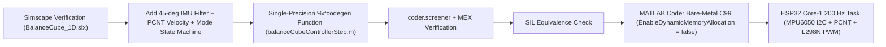

# 1-Wheel Balance Cube: Simscape Feasibility Study & MCU Deployment Plan

> [!TIP]
> **Feasibility Verdict: YES — physically buildable and controllable on your existing electronics.**
> With a **140 mm acrylic square**, a **90 mm rimmed brass flywheel (~387 g)**, and a **12 V low-ratio encoder motor (`JGB37-520 6.25:1`, `0.24 N*m` stall, `1600 RPM`)**, the 1D reaction-wheel proof-of-concept stabilizes cleanly in nonlinear 3D Simscape Multibody + Electrical simulation within your KiCad schematic's **L298N + 3 A polyfuse** limits (`2.79 A` peak, **~14 deg** nonlinear catch window).

---

## 1. Nonlinear 3D Simscape Model & Baseline Closed-Loop Proof

A full coupled electromechanical model was built in [BalanceCube_1D.slx](file:///home/thanotos/BalanceCube/simulink/BalanceCube_1D.slx) parameterized by [params_1d_cube.m](file:///home/thanotos/BalanceCube/simulink/params_1d_cube.m):

* **3D Mechanics (`Simscape Multibody`)**: Pivot revolute joint (`0.0005 N*m/(rad/s)` pillow-block bearing damping), `45 deg` rotated square acrylic brick (`140 x 140 x 6 mm` + `45 g` hardware), motor stator mass behind the plate, and custom-inertia rimmed brass flywheel (`90 mm` OD, `66 mm` inner web, `12 mm` rim width, `3 mm` web).
* **Electromechanics (`Simscape Electrical`)**: Permanent-magnet `DC Motor` coupled via `Rotational Multibody Interface` to the flywheel joint, driven by a `Controlled Voltage Source` clamped to your L298N effective rail (`12 V - 2.0 V = 10.0 V`) and monitored by a `Current Sensor`.
* **200 Hz Discrete 4-State LQR Controller (`Ts = 0.005 s`)**: Regulates $[\theta, \dot{\theta}, \omega_w, \int \omega_w\,dt]^T$ with output saturation (`+-10 V`), integrator anti-windup, and a `+-30 deg` fall cutoff switch.

### Key Baseline Simulation Observations (`8.0 s`)
| Metric | Value Observed | Physical Meaning |
|---|---|---|
| **Initial Recovery** | `5.00 deg -> 0.402 deg` in `~0.9 s` | Recovers smoothly from a `5 deg` release |
| **Tap Disturbance (`t = 2.5 s`, `0.04 N*m` for `0.1 s`)** | Peak deflection `0.885 deg`, full recovery | Rejects a hand tap cleanly without wheel runaway |
| **CoM Asymmetry Self-Trim (`+0.5 mm` offset)** | Settles to `+0.346 deg` (`|theta_dot| = 0.00005 rad/s`) | 4th integrator state finds exact center-of-gravity equilibrium |
| **Final Flywheel Speed** | Peaks `138.2 RPM`, settles `-1.46 RPM` | Returns wheel speed toward zero instead of drifting to saturation |
| **Peak Voltage / Armature Current** | `10.00 V` / `2.79 A` (`0.00062 A` steady-state) | Stays safely below the schematic's `3.0 A` polyfuse |

---

## 2. Parametric Physical Feasibility Findings

All sweeps were generated by [analyze_feasibility.m](file:///home/thanotos/BalanceCube/simulink/analyze_feasibility.m):

### 2.1 Motor Choice Makes or Breaks the Build (140 mm Square, 90 mm Brass Wheel)
| Motor + Driver | Motor Mass | Stall Current @ V_eff | No-Load Speed @ V_eff | Linear Recoverable Tilt | `6 deg` Simscape Peak Current | `6 deg` Simscape Outcome |
|---|---:|---:|---:|---:|---:|---|
| **RS-385 Direct (L298N)** | `80 g` | `2.29 A` | `7500 RPM` | `3.08 deg` | `2.29 A` | **FAIL (Falls)** — too little stall torque (`0.035 N*m`) |
| **JGB37-520 30:1 (L298N)** | `155 g` | `1.80 A` | `275 RPM` | `11.36 deg` | `1.79 A` | Recovers, but real gearbox backlash + low `275 RPM` ceiling |
| **JGB37-520 6.25:1 (L298N)** | `155 g` | `2.79 A` | `1333 RPM` | `14.98 deg` | `2.79 A` | **Sweet Spot** — within `3 A` fuse, `14 deg` max nonlinear catch |
| **RS-555 Direct (L298N)** | `220 g` | `8.51 A` | `3750 RPM` | `17.18 deg` | `8.49 A` | Recovers, **but blows `3 A` fuse / overloads L298N** |
| **BLDC Gimbal / 24H (MOSFET)** | `130 g` | `10.30 A` | `3933 RPM` | `25.65 deg` | `10.14 A` | Best authority & zero backlash; requires `>10 A` MOSFET/FOC driver |

### 2.2 Flywheel Geometry, Square Size & Jump-Up Reality
1. **Flywheel (`Panel C`)**: Increasing **outer diameter** (`45–55 mm` radius) improves inertia quadratically ($I_w \propto r^4$), whereas overly thick wheels (`> 500 g`) add gravitational torque $Mgl$ faster than useful reaction authority. Aim for **`85–100 mm` OD rimmed brass (`250–400 g`)**.
2. **Square Side Length (`Panel D`)**: Nonlinear Simscape max recoverable angle scales cleanly with smaller frames (`>= 24 deg` at `100 mm`, `>= 14 deg` at `140 mm`, `>= 8 deg` at `180 mm`). A **`120–150 mm` square** balances easy assembly with strong balance margins and a comfortable `~90–105 ms` open-loop fall time constant.
3. **Driver Upgrade**: Swapping the L298N (`~2.0 V` drop) for a MOSFET driver (`~0.2 V` drop, e.g. `DRV8874` / `BTS7960`) raises recoverable tilt from **`~15 deg` to `~18 deg`** without touching the motor.
4. **45-deg Floor Jump-Up vs. Hand Launch**: At `45 deg` resting on the table, gravity torque is **`0.424 N*m`**, whereas this motor's peak `10 V` stall torque is **`0.200 N*m`** (and even theoretical `2*V_max` reverse-plugging is `0.400 N*m` at `5.6 A`). Meanwhile, the flywheel spinning at `1333 RPM` already stores **`2.39x`** the energy needed (`0.419 J` transferable vs `0.175 J` required) if snapped by a physical brake. **Conclusion**: Launch the 1-wheel PoC **by hand near upright (`+-14 deg`)**, or add a mechanical servo brake if floor jump-up is desired.

---

## 3. Simulink-to-ESP32 Controller & Codegen Pipeline

Full implementation details, `%#codegen` MATLAB source, and ESP32 C integration code are documented in [Controller_and_MCU_Codegen_Plan.md](file:///home/thanotos/BalanceCube/docs/Controller_and_MCU_Codegen_Plan.md).

### Summary of Implemented MATLAB Coder -> ESP32 C99 Deployment
1. **Motor Options Recorded**: All 5 motor/driver trade-offs and parameter-update instructions are recorded in [Motor_Selection_Options.md](file:///home/thanotos/BalanceCube/docs/Motor_Selection_Options.md), with **12 V `JGB37-520 6.25:1` (`1600 RPM`, `0.24 N*m`, `275` 4x CPR)** locked in as the active baseline.
2. **Codegen-Ready Single-Precision Controller**: [balanceCubeControllerStep.m](file:///home/thanotos/BalanceCube/codegen/balanceCubeControllerStep.m) and [defaultControllerConfig.m](file:///home/thanotos/BalanceCube/codegen/defaultControllerConfig.m) implement the `45 deg` IMU frame rotation, `2 s` gyro bias calibration, complementary tilt filter ($\alpha = 0.992$), `int32` encoder differentiation + `30 Hz` LPF, 4-mode safety supervisor, and `float32` anti-windup LQR with runtime-tunable struct `BalanceCubeConfig_T`.
3. **Verified Static C99 Library & ESP32 Firmware**: [build_esp32_controller.m](file:///home/thanotos/BalanceCube/codegen/build_esp32_controller.m) passed `coder.screener` (0 issues), `coder.runTest` on **MEX** and **SIL**, and [tBalanceCubeController.m](file:///home/thanotos/BalanceCube/codegen/tBalanceCubeController.m) (`8/8` MATLAB Test cases passed), exporting bare-metal 32-bit C99 (`balanceCubeControllerStep.c` = `5,895 bytes`, **0 dynamic allocations**) to `firmware/balance_controller_c/`.
4. **Closed-Loop Simscape Verification of Compiled C99 SIL Code**: [BalanceCube_1D_MCU.slx](file:///home/thanotos/BalanceCube/simulink/BalanceCube_1D_MCU.slx) and [verify_codegen_in_simscape.m](file:///home/thanotos/BalanceCube/simulink/verify_codegen_in_simscape.m) verified the compiled `balanceCubeControllerStep_sil` C99 binary with `45 deg` IMU noise and `275 CPR` integer encoder quantization directly against the 3D Simscape plant (`0.105 deg` RMSE vs. ideal double-precision LQR, `0.336 deg` steady tilt, `-1.18 RPM` final wheel speed, `2.79 A` peak current).

5. **Scale to 2-Wheel / 3-Wheel Cubli**: Keep this 1-wheel rig as your controls & estimation testbed, then upgrade to **brushless reaction-wheel motors + FOC/MOSFET drivers + 3S LiPo** before moving to 2-wheel and 3-wheel stages.

---

## 4. KiCad Schematic Fixes (`Balance_cube.kicad_sch`)

Five hardware bugs found in the original schematic were repaired and verified to **0 ERC errors** via `kicad-cli sch erc` (full details in [KiCad_Schematic_Audit.md](file:///home/thanotos/BalanceCube/docs/KiCad_Schematic_Audit.md)):

* Swapped `U2` (`L298N`) `Vs` (`+12V`) and `Vss` (`+5V`) power pins (previously inverted, which would destroy the logic rail).
* Grounded `U2` `SENSE_A` (Pin 1) and `SENSE_B` (Pin 15) instead of leaving H-bridge emitter returns floating.
* Replaced the single dead-short diode across reversible motor `M1` with a **4-diode `1N5822` Schottky clamp bridge** (`D1, D3, D4, D5`).
* Switched Encoder `J2` and SPI OLED `J4` power from `+5V` to **`+3.3V`** to protect non-5V-tolerant ESP32 GPIOs.
* Moved `/IN2` off `GPIO12` (ESP32 flash-voltage strapping pin) to **`GPIO32`**, added NPN driver `Q1` (`2N3904`) + flyback `D7` for `BZ1`, and added `D6` (`1N4148`) + `C4` (`100 nF`) on `D2` (`WS2812B`).

---

## 5. Complete Flashable ESP32 Firmware & Host Verification

A dual-core **PlatformIO / ESP-IDF** project is ready under `firmware/` (`pio run -t upload` or `idf.py build flash`):
* [board_pins.h](file:///home/thanotos/BalanceCube/firmware/include/board_pins.h) & [hal_esp32.c](file:///home/thanotos/BalanceCube/firmware/src/hal_esp32.c): `400 kHz` I2C `MPU6050` with `0x69`/`0x68` auto-probe (`JP1`), `PCNT` 4x quadrature decoder, `20 kHz` ultrasonic `LEDC` PWM, SPI `SSD1306` OLED telemetry, RMT `WS2812B`, and `GPIO33` buzzer chirp.
* [main.c](file:///home/thanotos/BalanceCube/firmware/src/main.c), [app_controller.c](file:///home/thanotos/BalanceCube/firmware/src/app_controller.c), & [cli_tuning.c](file:///home/thanotos/BalanceCube/firmware/src/cli_tuning.c): Core-1 `200 Hz` real-time loop + Core-0 `20 Hz` UI and live UART tuning (`status`, `reset`, `set k1..k4`, `set trim`, `set db`, `set vmax`, `set cpr`).
* Verified cleanly under Linux `gcc -std=c99 -Wall -Wextra -Werror` via [test_firmware_host.c](file:///home/thanotos/BalanceCube/firmware/test_host/test_firmware_host.c) (`startup calib -> idle -> balance -> CLI -> fault OK`).

---

## 6. Realistic Non-Ideal Startup, Backlash, Stiction & Fault Lifecycle (`12.0 s`)

[BalanceCube_1D_Realistic.slx](file:///home/thanotos/BalanceCube/simulink/BalanceCube_1D_Realistic.slx) and [simulate_realistic_startup.m](file:///home/thanotos/BalanceCube/simulink/simulate_realistic_startup.m) test the compiled C99 SIL binary (`0.42 V` smooth anti-chatter deadband comp) against **`1.0 deg` spur-gear backlash**, **`10 mN*m` brush stiction**, **`+-45 deg` table stops**, **motor-side `275 CPR` quantization**, and **`+0.04 rad/s` gyro bias**:
* Boots resting on the `+45 deg` table stop for `2.0 s` (`MODE_CALIB`), transitions to `MODE_IDLE`, catches smoothly when hand-lifted upright (`0.40 deg`), rejects the `5.0 s` tap, trips `MODE_FAULT` cleanly onto the `45.09 deg` table stop when shoved at `7.0 s`, and automatically re-arms to `0.31 deg` (`-0.34 RPM`, `2.81 A` peak `< 3 A` fuse) when lifted again at `9.0 s`.

---

## 9. FreeCAD MCP Setup & Mechanical 3D CAD Fabrication Suite

Installed `freecad-mcp` (`v0.1.32`, protocol `v3`) into Snap FreeCAD (`~/snap/freecad/common/Mod/FreeCADMCP` + `/home/thanotos/.local/share/FreeCAD/v1-1/Mod/FreeCADMCP` with `auto_start_rpc: true`), synced its `uv` environment, and registered `"freecad"` in `~/.gemini/config/mcp_config.json`.

Generated the complete parametric CAD suite from [generate_cad_models.py](file:///home/thanotos/BalanceCube/cad/generate_cad_models.py) matching `params_1d_cube.m` inside live FreeCAD GUI and verified every part against OCCT geometry, mass/inertia, and `±45°` swing clearance:

* **Square Acrylic Diamond (`140 × 140 × 6 mm`)**: `1:1` laser-cut DXF ([Square_Frame_140mm_LaserCut.dxf](file:///home/thanotos/BalanceCube/cad/exports/Square_Frame_140mm_LaserCut.dxf)), `0.1375 kg`, with `Ø8.2 mm` pivot bore, `JGB37-520` `Ø31 mm` 6-hole BC, symmetric top `MPU6050` mount at `Z = 141.0 mm`, and lower-right zip-tie strain-relief slots.
* **Machined C36000 Brass Flywheel (`Ø90 mm × 12 mm`, `Ø66 mm` pocket, `3 mm` web)**: [Brass_Flywheel_90mm.step](file:///home/thanotos/BalanceCube/cad/exports/Brass_Flywheel_90mm.step), `0.3989 kg`, `Ø6.0 mm` D-bore (`5.50 mm` flat) + radial `M3` set-screw tap; OCCT spin inertia **`5.1376 × 10⁻⁴ kg·m²`** (`0.10%` of `params_1d_cube.m`).
* **Split-Collar Pivot Clamp Hub**: [Pivot_Clamp_Hub.stl](file:///home/thanotos/BalanceCube/cad/exports/Pivot_Clamp_Hub.stl) / `.step` (`6.16 mm` V-saddle slot + `3× M3` bolts + `Ø8.06 mm` pinch clamp).
* **Base Plate & Exact `±45.00°` Rest Stops**: [Base_And_Stops.step](file:///home/thanotos/BalanceCube/cad/exports/Base_And_Stops.step) / `.stl` (`2× KP08` risers + `X = ±65 mm` stops at `Z = -10.6066 mm`), verified **`0.0 mm³` collision** across `-45°`, `0°`, and `+45°`.

Full assembly details, hardware fasteners, and customization steps are documented in [CAD_Fabrication_Guide.md](file:///home/thanotos/BalanceCube/docs/CAD_Fabrication_Guide.md).

